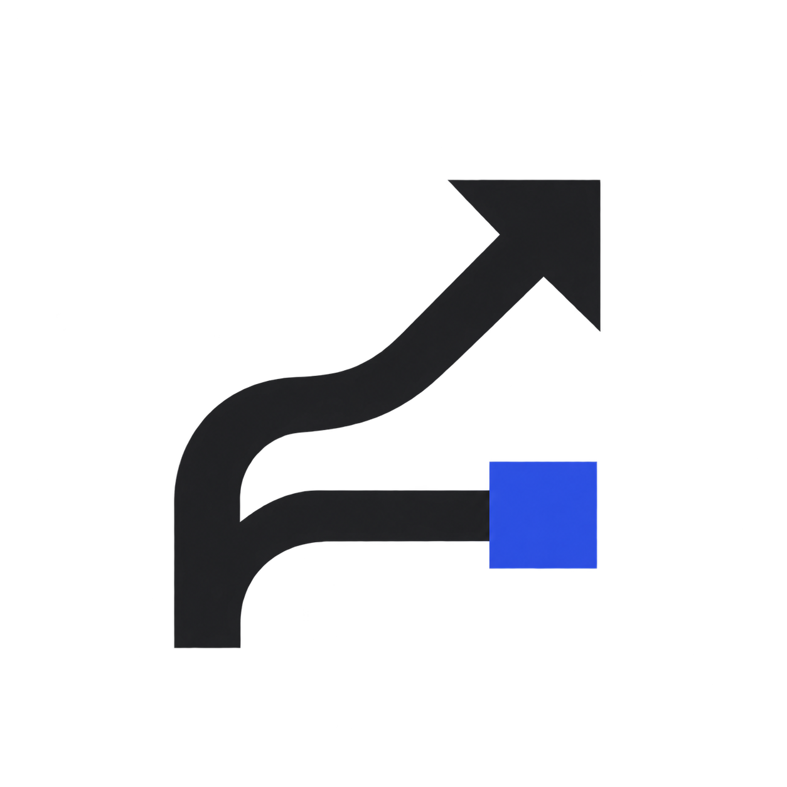

<p align="center"></p>

<h1 align="center">PR &amp; Release Workspace</h1>

<p align="center">Review pull requests, diffs and local notes in DSH, then verify each release fact from merge to the live market.</p>

<p align="center"><a href="README.zh.md">简体中文</a> · <a href="README.md">English</a></p>

[](https://github.com/tangyixiao/dsh-pr-release-workspace/stargazers) [](https://github.com/tangyixiao/dsh-pr-release-workspace/actions/workflows/ci.yml) [](LICENSE) [](https://www.npmjs.com/package/dsh-pr-release-workspace)

<p align="center">
  <picture><source media="(prefers-color-scheme: dark)" srcset="docs/assets/feature-1-en-dark.svg"></picture>
  <picture><source media="(prefers-color-scheme: dark)" srcset="docs/assets/feature-2-en-dark.svg"></picture>
  <picture><source media="(prefers-color-scheme: dark)" srcset="docs/assets/feature-3-en-dark.svg"></picture>
</p>

## Get started

Desktop: install the release `.tgz` through Extensions → Plugin Management → Add Plugin. For a Web profile you explicitly control:

```sh
dsh plugin --profile web add dsh-pr-release-workspace@0.1.4
```

Install and sign in to GitHub CLI with `gh auth login`. Open Pull requests and paste a PR URL or `owner/repo#123`; team lists require the relevant `read:org` permission.

## Status and compatibility

| Item | Current source of truth |
| --- | --- |
| Source version | `0.1.4` · 以 [package.json](package.json) 为准 |
| Distribution | `npm` · [Releases](https://github.com/tangyixiao/dsh-pr-release-workspace/releases) |
| DSH | `>=0.1.6-alpha.2 <0.3.0-0` |
| Node.js | `>=22` |
| Development | [Open issues](https://github.com/tangyixiao/dsh-pr-release-workspace/issues?q=is%3Aissue+is%3Aopen) · [CI](https://github.com/tangyixiao/dsh-pr-release-workspace/actions) |

GitHub reads use your existing gh session. Local notes are not automatically posted as GitHub comments, and a merged PR does not establish package or market publication.

[Detailed usage, configuration and troubleshooting](docs/guide.en.md)

## Development and participation

```sh
npm ci --ignore-scripts
npm test
npm run build
node tools/check-repository.mjs
```

[Contributing](CONTRIBUTING.md) · [Support](SUPPORT.md) · [Questions](https://github.com/tangyixiao/dsh-pr-release-workspace/discussions) · [Report a bug](https://github.com/tangyixiao/dsh-pr-release-workspace/issues/new/choose) · [Security](SECURITY.md) · [Maintenance](docs/maintenance.md)

## Star History

<picture><source media="(prefers-color-scheme: dark)" srcset="https://api.star-history.com/chart?repos=tangyixiao/dsh-pr-release-workspace&amp;type=date&amp;theme=dark&amp;legend=top-left"></picture>

[Interactive chart](https://www.star-history.com/?repos=tangyixiao%2Fdsh-pr-release-workspace&type=date) · [GitHub Stars](https://github.com/tangyixiao/dsh-pr-release-workspace/stargazers)

The external chart uses real star records and may be cached or unavailable; no development percentage is inferred.

## Origin and licenses

[Software license](LICENSE) · [Logo artwork and attribution](assets/NOTICE.md)

Software retains its existing license. Whale-girl derivative artwork is separately CC BY-NC-SA 4.0 with the attribution chain for 上善, ZipZipPipe and Small-tailqwq.
