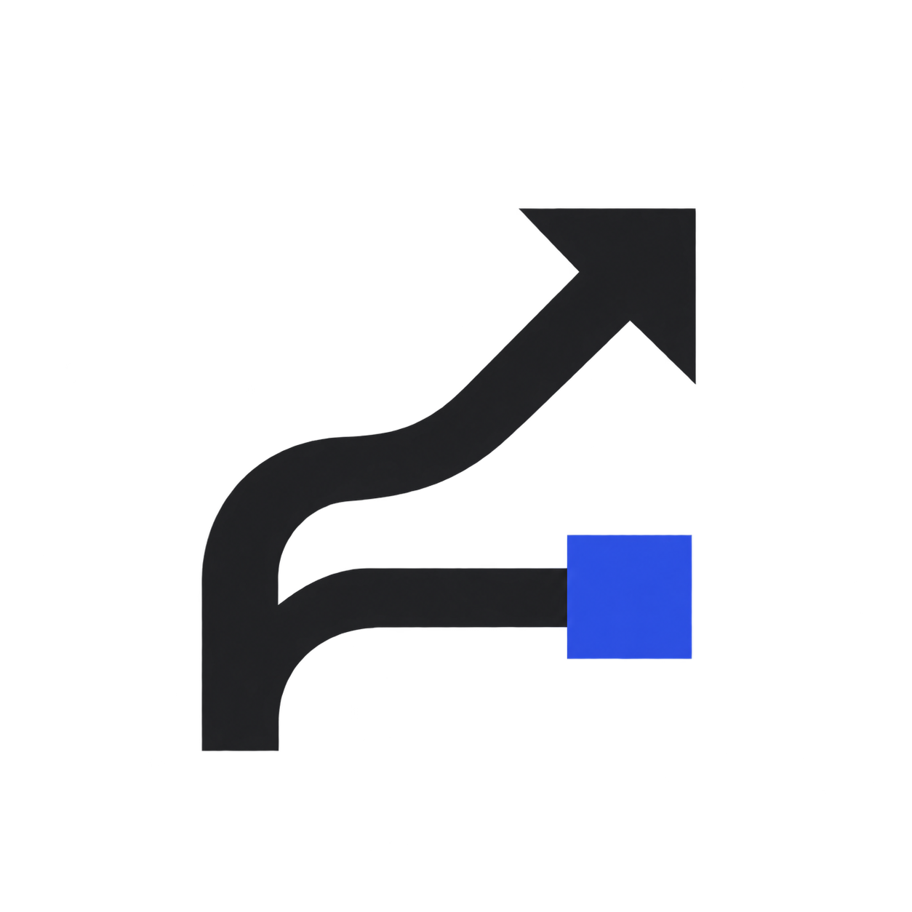
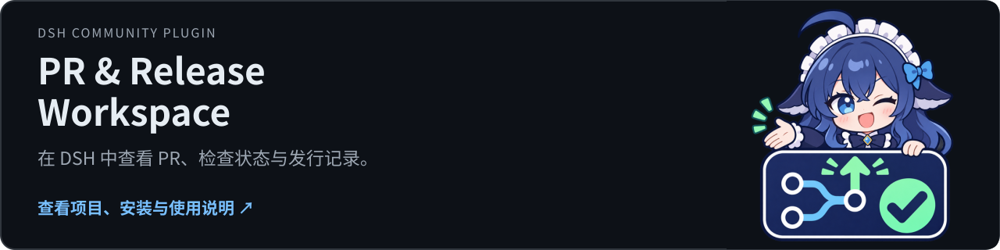

<p align="center"></p>

<h1 align="center">PR &amp; Release Workspace</h1>

<p align="center">在 DSH 查看 PR、差异与本地批注，并逐项核对从合并到在线市场的发布证据。</p>

<p align="center"><a href="https://github.com/tangyixiao/dsh-pr-release-workspace"></a></p>

<p align="center"><a href="README.zh.md">简体中文</a> · <a href="README.md">English</a></p>

[](https://github.com/tangyixiao/dsh-pr-release-workspace/stargazers) [](https://github.com/tangyixiao/dsh-pr-release-workspace/actions/workflows/ci.yml) [](LICENSE) [](https://www.npmjs.com/package/dsh-pr-release-workspace)

<p align="center">
  <picture><source media="(prefers-color-scheme: dark)" srcset="docs/assets/feature-1-zh-CN-dark.svg"></picture>
  <picture><source media="(prefers-color-scheme: dark)" srcset="docs/assets/feature-2-zh-CN-dark.svg"></picture>
  <picture><source media="(prefers-color-scheme: dark)" srcset="docs/assets/feature-3-zh-CN-dark.svg"></picture>
</p>

## 开始使用

Desktop：从发行页下载 `.tgz`，在“扩展 → 插件管理 → 添加插件”中安装。命令行示例用于你明确控制的 Web profile：

```sh
dsh plugin --profile web add dsh-pr-release-workspace@0.1.4
```

先安装并登录 GitHub CLI：`gh auth login`。打开左侧 Pull requests，粘贴完整 PR 链接或 `owner/repo#123`；团队列表需要对应 `read:org` 权限。

## 当前状态与兼容性

| 项目 | 当前依据 |
| --- | --- |
| 源码版本 | `0.1.4` · 以 [package.json](package.json) 为准 |
| 分发方式 | `npm` · [Releases](https://github.com/tangyixiao/dsh-pr-release-workspace/releases) |
| DSH | `>=0.1.6-alpha.2 <0.3.0-0` |
| Node.js | `>=22` |
| 开发状态 | [Open issues](https://github.com/tangyixiao/dsh-pr-release-workspace/issues?q=is%3Aissue+is%3Aopen) · [CI](https://github.com/tangyixiao/dsh-pr-release-workspace/actions) |

GitHub 读取使用已有 `gh` 会话。本地批注不会自动发布为 GitHub 评论；合并 PR 也不会自动证明包或市场已更新。

[详细使用、配置与故障排查](docs/guide.zh-CN.md)

## 开发与参与

```sh
npm ci --ignore-scripts
npm test
npm run build
node tools/check-repository.mjs
```

[Contributing](CONTRIBUTING.md) · [Support](SUPPORT.md) · [Questions](https://github.com/tangyixiao/dsh-pr-release-workspace/discussions) · [Report a bug](https://github.com/tangyixiao/dsh-pr-release-workspace/issues/new/choose) · [Security](SECURITY.md) · [Maintenance](docs/maintenance.md)

## Star History

<picture><source media="(prefers-color-scheme: dark)" srcset="https://api.star-history.com/chart?repos=tangyixiao/dsh-pr-release-workspace&amp;type=date&amp;theme=dark&amp;legend=top-left"></picture>

[Interactive chart](https://www.star-history.com/?repos=tangyixiao%2Fdsh-pr-release-workspace&type=date) · [GitHub Stars](https://github.com/tangyixiao/dsh-pr-release-workspace/stargazers)

图表由外部服务按真实星标数据生成，可能缓存或暂时不可用；未填造开发百分比。

## 来源与许可

[Software license](LICENSE) · [Logo artwork and attribution](assets/NOTICE.md)

软件保持原许可证；鲸鱼娘衍生美术单独采用 CC BY-NC-SA 4.0，并保留上善、ZipZipPipe、Small-tailqwq 的署名链。
